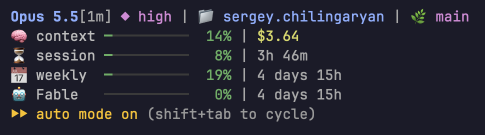

# cc-statusline-chili-edition 🌶️

An informative multi-line status line for [Claude Code](https://code.claude.com): model & repo identity, context usage, session cost, reasoning mode, and account limits (quota + credits) as segmented bars.



## Install

```bash
curl -fsSL https://raw.githubusercontent.com/sergchil-tb/cc-statusline-chili-edition/main/install.sh | bash
```

Or clone and run:

```bash
git clone https://github.com/sergchil-tb/cc-statusline-chili-edition.git
cd cc-statusline-chili-edition && ./install.sh
```

The installer copies `statusline.sh` to `~/.claude/` (backing up any existing one) and sets `statusLine` in `~/.claude/settings.json`. Open Claude Code to see it.

## What it shows

```
Opus 4.8[1m] ◆ high │ 📁 project │ 🌿 branch ← model (·[1m] = 1M ctx) · thinking/effort · folder · git branch
🧠 context ━━────────  24% │ $9.38           ← context used · session cost
🚦 quota   ━━━━──────  45% 🔄 18 days        ← rate-limit / plan quota + reset
💳 credits ━─────────   7% $21/$300          ← extra credits used / limit
```

Rows are columns — icon, label, bar, percentage (right-aligned), detail — so they line up like a table.

Bars are a coloured line on a thin grey track: green ≤ 50% · yellow 51–80% · red > 80%. On Pro/Max the limit rows show 5-hour (⏳) and weekly (📅) instead of the enterprise quota, plus one 🤖 row per model with its own weekly cap (e.g. Fable).

## Requirements

The installer auto-installs any missing CLI deps (`jq`, `git`, `curl`, `awk`) via Homebrew. You just need a 256-color + emoji-capable terminal.

## Customize

All in `statusline.sh` — bar width (`10`), glyphs (`━` fill on a `─` track, narrow so stacked bars keep a gap; keep them to characters your terminal font has, or they render at the wrong width), and 256-color codes.

MIT © [Sergey Chilingaryan](https://github.com/sergchil-tb)
